<h1 align="center">
  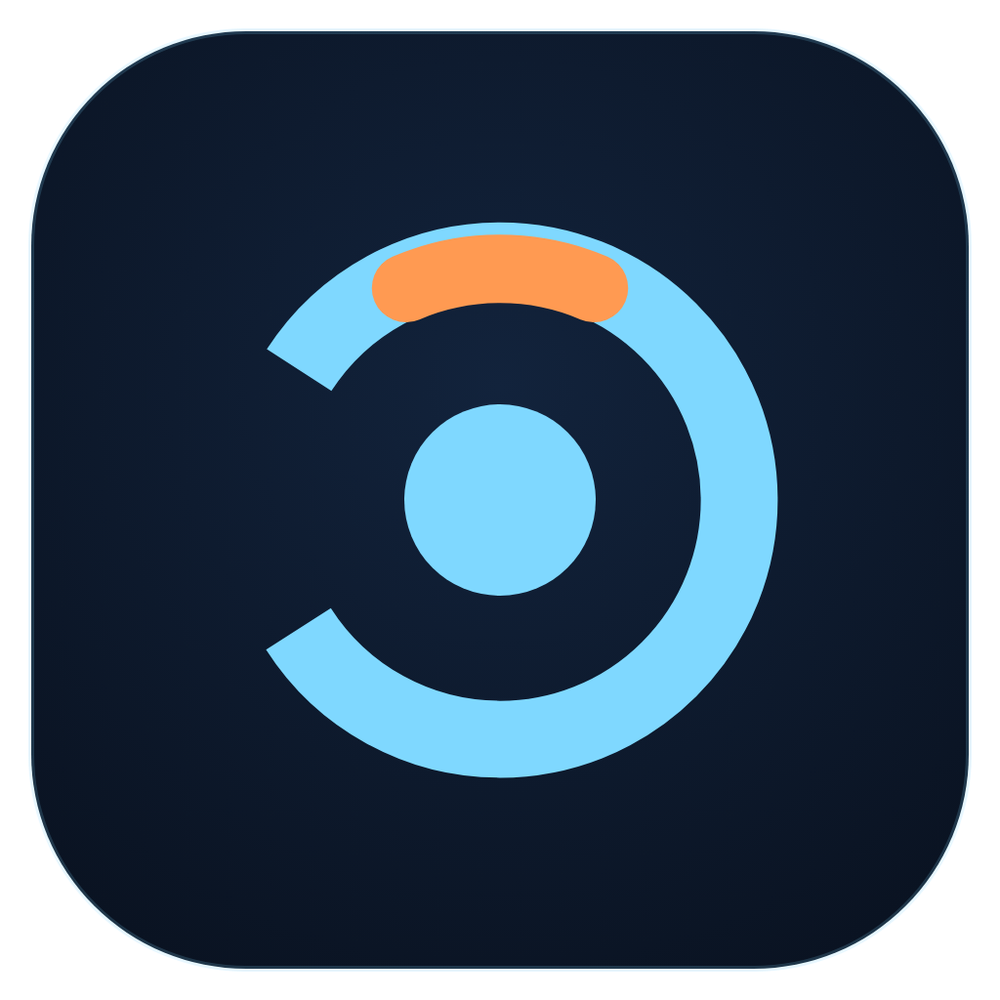<br>
  Kairo Launcher
</h1>

<p align="center">
  <b>Kairo, Kairo Void, plain Minecraft and your own modded installs, behind one Play button.</b><br>
  Free, open source, no telemetry. By Mordsome.
</p>

<p align="center">
  <a href="https://github.com/Mordsome/KairoLauncher/releases/latest">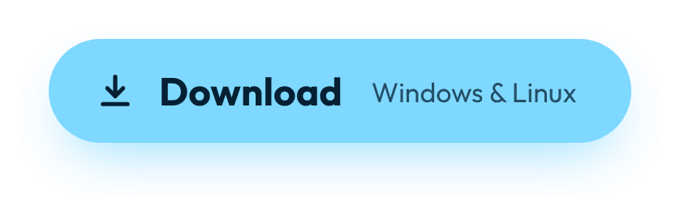</a>
</p>

<p align="center">
  <a href="https://mordsome.github.io/KairoLauncher/">Website</a> ·
  <a href="#features">Features</a> ·
  <a href="#install">Install</a> ·
  <a href="#privacy--security">Privacy &amp; security</a> ·
  <a href="https://github.com/Mordsome/Kairo">The Kairo client</a>
</p>

> **Not an official Minecraft product. Not approved by or associated with Mojang or Microsoft.**

<p align="center">
  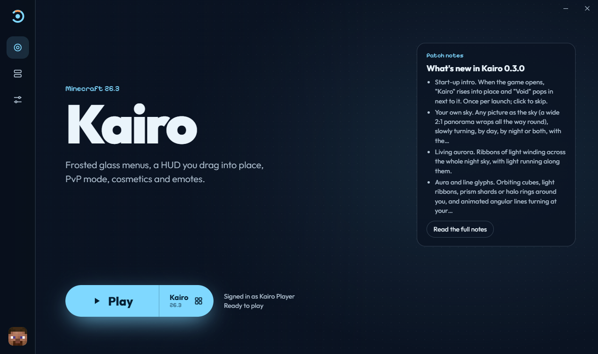
</p>

## Features

### Kairo and Kairo Void, one click away

Pick Kairo or Kairo Void and press Play. The launcher installs Fabric, Fabric API, Sodium and
the right Kairo jar from the [official releases](https://github.com/Mordsome/Kairo/releases),
checks every file, and keeps them all updated together. Pick Kairo Void and the whole launcher
turns violet.

| Choose what to play | Kairo Void selected |
| --- | --- |
| 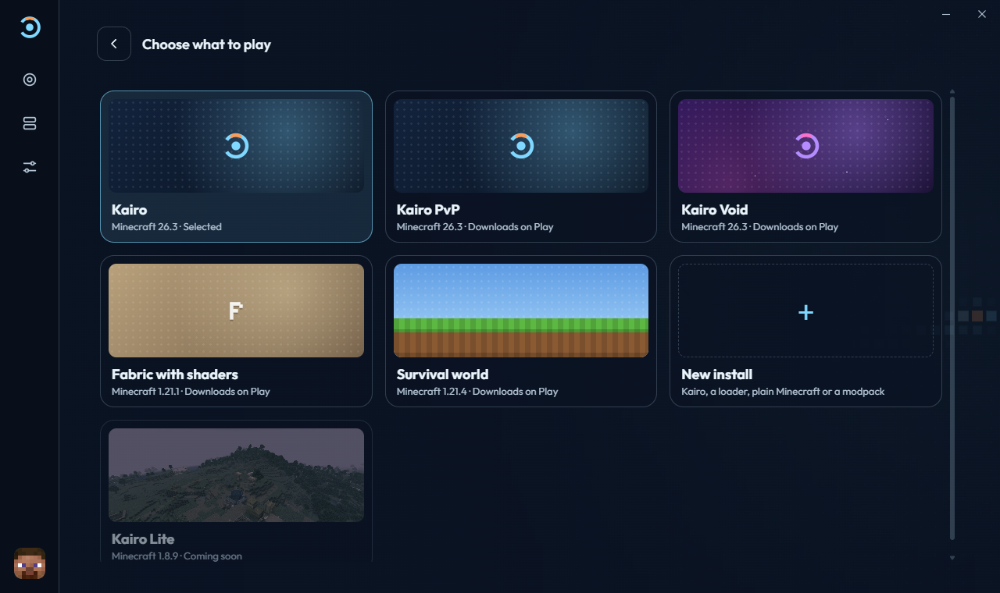 | 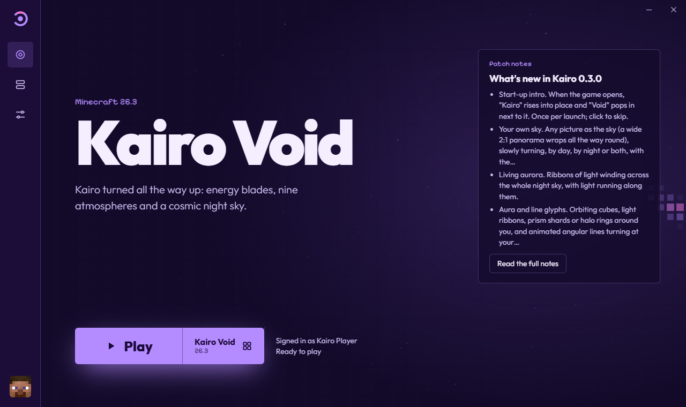 |

### Any Minecraft, any loader

Every release from 1.8 to the newest, straight from Mojang. Or build your own install with
**Fabric, NeoForge, Forge or OptiFine**, add **Sodium, Iris and Lithium**, or import a **Modrinth
modpack**. Each install has its own mods, worlds and settings, so nothing gets mixed up. The right
Java for each version downloads by itself.

| New install | Library |
| --- | --- |
| 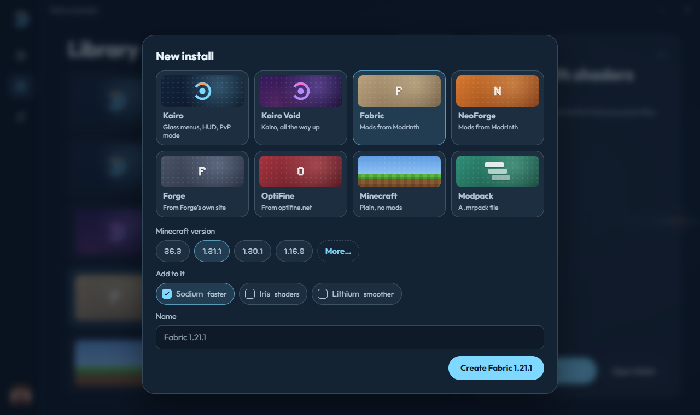 | 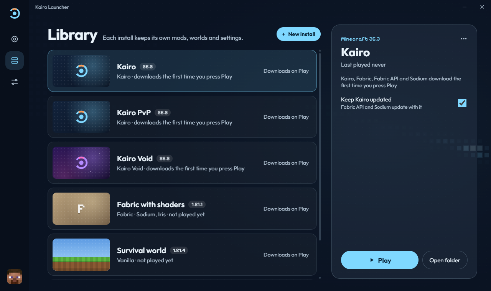 |

### Mods from Modrinth

Search Modrinth from inside an install, pick several mods and install them together, with their
dependencies. Only mods made for exactly that loader and Minecraft version show up. Turn mods on
and off, or remove them, in one click.

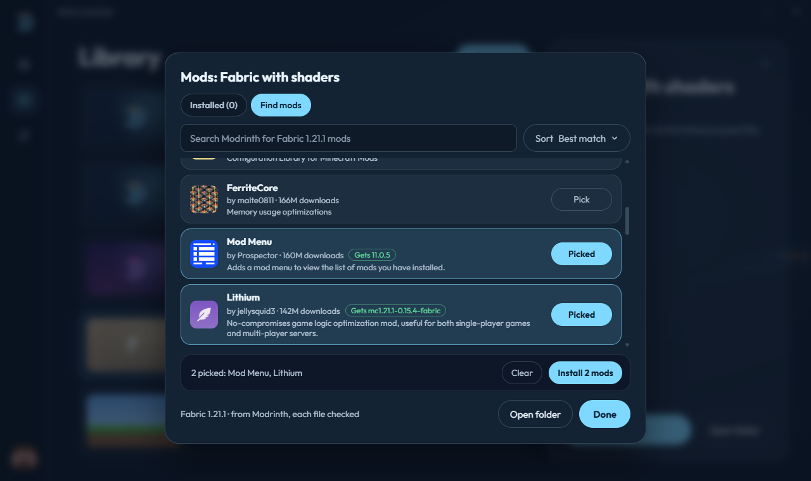

### A look for every install

Give each install its own accent colour, corners (Round, Soft or Sharp) and background picture.
The launcher takes that look whenever the install is selected. Behind it all: a calm **Pixel
field** that follows your mouse, slow **Aurora** light, or your own picture or GIF.

| Appearance | That install's own look |
| --- | --- |
| 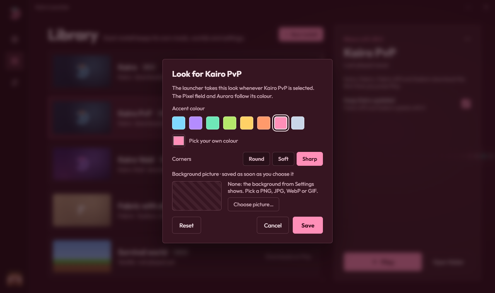 | 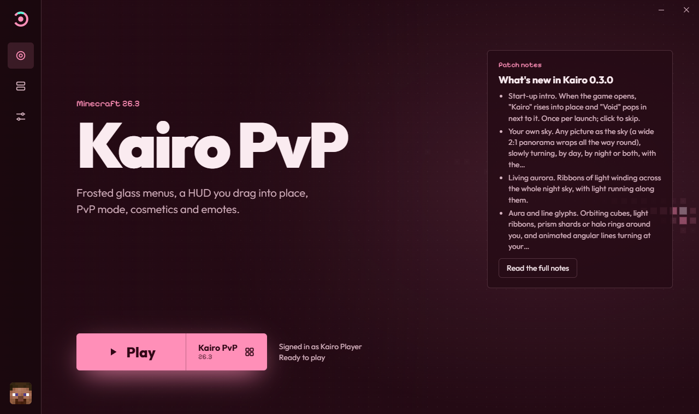 |
| **Its own background picture** | **Aurora** |
| 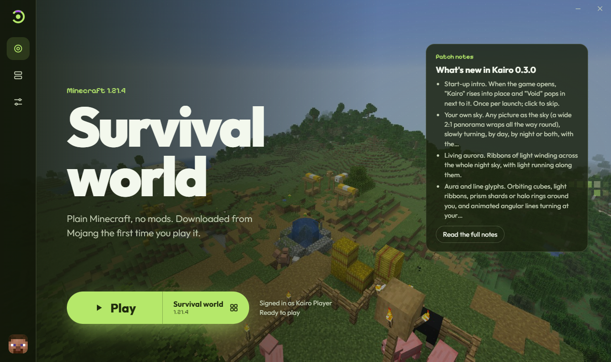 | 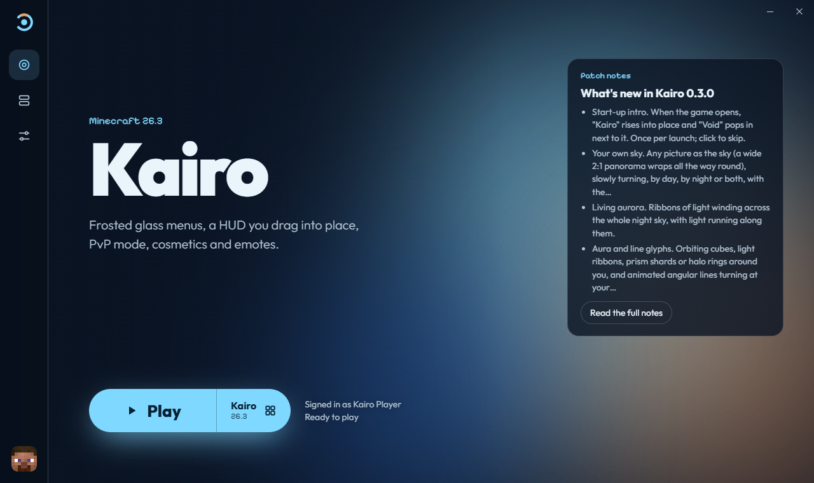 |

### Home your way, and all your accounts

Four Home layouts: Classic, Centred, Side panel and Bottom bar. Sign in with as many Microsoft
accounts as you like, and switch between them from the bottom of the rail. Each account's
picture is the head of the skin it wears.

| Home layout: Side panel | Accounts |
| --- | --- |
| 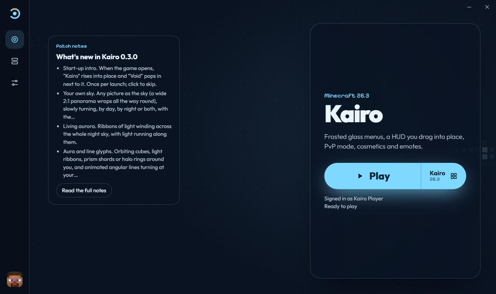 | 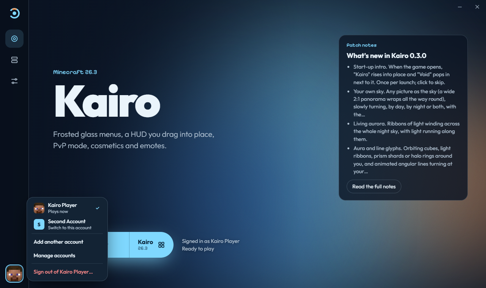 |

### And the small things

- **Patch notes** for the latest Kairo, right on Home.
- **Live game log**, and a plain-words explanation when Minecraft crashes, with the crash report one
  click away.
- **Share your `.minecraft`** if you like: your worlds, packs and settings, while mods stay in each
  install's own folder.
- **Keyboard-friendly**, readable contrast, and **Reduce motion** keeps everything still.

## Install

**Windows 10 / 11:** download `KairoLauncher-Setup-<version>.exe` from the
[latest release](https://github.com/Mordsome/KairoLauncher/releases/latest) and run it. The installer
isn't code-signed yet, so Windows SmartScreen may say it "protected your PC": choose
**More info → Run anyway**.

**Linux:** download `KairoLauncher-<version>.AppImage`, make it executable
(`chmod +x KairoLauncher-*.AppImage`) and run it. Saving your sign-in needs a Secret Service
keyring (GNOME Keyring or KWallet), which most desktops have.

You need a Minecraft: Java Edition account. The launcher downloads Minecraft and Java from Mojang,
and loaders and mods from their official sources. It doesn't bundle any of them.

The launcher **updates itself**: an update downloads in the background and installs when you restart
the launcher, never while Minecraft is running.

## Privacy & security

- **Microsoft sign-in happens in your browser**, on Microsoft's own page. The launcher never sees your
  password.
- **Your sign-in stays in your system's secure storage** (Windows Credential Manager, macOS Keychain or
  the Secret Service keyring on Linux), never in a plain file.
- **Every download is checked** against its official hash, and **every launcher update must carry
  Mordsome's signature**, so a fake update can't be installed even if someone got into this GitHub
  account.
- **No analytics, no telemetry, no accounts of our own.** The launcher only talks to Microsoft, Xbox
  and Mojang, Fabric, NeoForge, Forge, Modrinth and GitHub, as listed in Settings → Privacy.
- Logs and error messages hide your user folder's name.

Found a security problem? Please report it privately, see [SECURITY.md](SECURITY.md). The review done
before the first release is in [docs/SECURITY_REVIEW.md](docs/SECURITY_REVIEW.md).

## Uninstall

**Windows:** Settings → Apps → Installed apps → Kairo Launcher → Uninstall. The uninstaller removes
only the files the installer put there, one by one. It then asks whether to delete your installs and
sign-ins too, and the answer starts on **No**, which keeps everything for next time. It never touches
your `.minecraft` folder.

**Linux:** delete the AppImage. Your installs live in the launcher's data folder
(`~/.config/Kairo Launcher`).

## Building from source

Needs [Node.js](https://nodejs.org/) 22.12 or newer.

```bash
git clone https://github.com/Mordsome/KairoLauncher.git
cd KairoLauncher
npm install
npm run dev          # run it with hot reload
npm run dist:win     # build the Windows installer into release/
npm run dist:linux   # build the Linux AppImage into release/ (on Linux)
```

Every command, how installs and downloads work, and where the launcher keeps things:
**[docs/HOW_IT_WORKS.md](docs/HOW_IT_WORKS.md)**. Releasing: [docs/RELEASING.md](docs/RELEASING.md).
Signing in from your own build needs your own Microsoft app registration:
[docs/AUTH_SETUP.md](docs/AUTH_SETUP.md).

## Licence

Kairo Launcher is free software under the [GNU GPL v3.0](LICENSE). Copyright © 2026 Mordsome. You can
use, change and share it, as long as what you share stays under the same licence, with its source and
credit to the original. Fonts and other parts are listed in [THIRD_PARTY_NOTICES.md](THIRD_PARTY_NOTICES.md).

Minecraft is a trademark of Mojang Synergies AB. Fabric, NeoForge, Forge, OptiFine, Sodium, Iris,
Lithium and Modrinth are separate projects with their own licences, and none of them is bundled.
